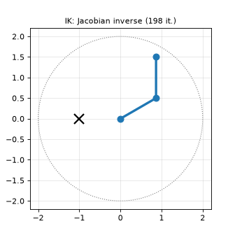
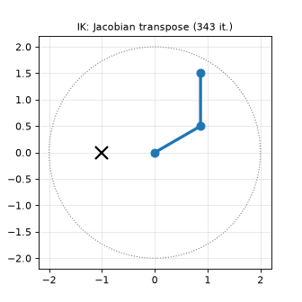
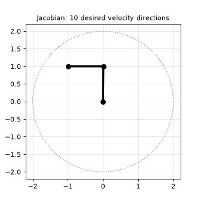
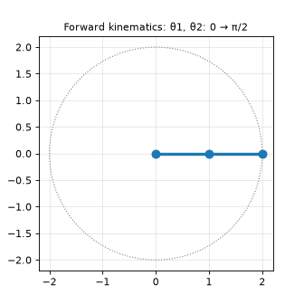
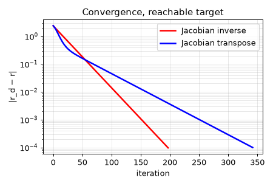
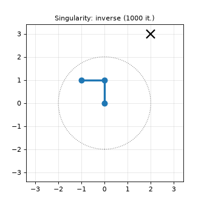
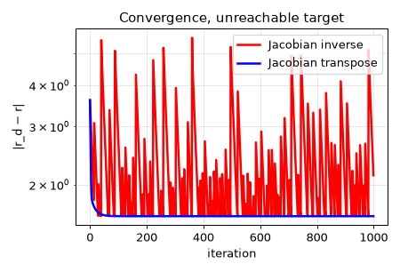
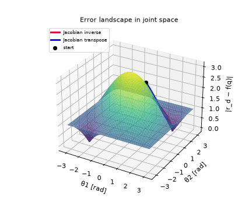
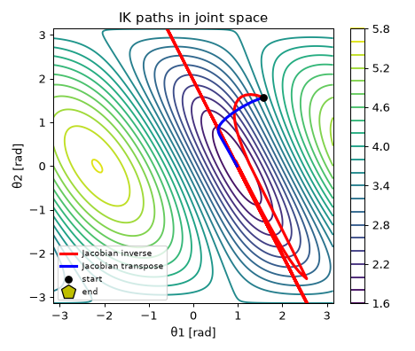

# 2D Planar Manipulator: Kinematics, Jacobian and Inverse Kinematics

MATLAB simulation of a planar two-link (2R) robotic arm with revolute joints, link lengths L1 = L2 = 1. Developed for the Robotics course (Phelma 3A, KOBE).

<p align="center">
  
  
  
</p>

## Overview

| # | Capability | Implementation | Demo |
|---|------------|----------------|------|
| 1 | Forward kinematics | [forward_kinematics.m](forward_kinematics.m) | [Section 1](#1-forward-kinematics) |
| 2 | Jacobian and velocity control | [compute_jacobian.m](compute_jacobian.m) | [Section 2](#2-jacobian-and-velocity-control) |
| 3 | Inverse kinematics (Jacobian inverse vs. transpose) | [inverse_kinematics_inverse.m](inverse_kinematics_inverse.m), [inverse_kinematics_transpose.m](inverse_kinematics_transpose.m) | [Section 3](#3-inverse-kinematics) |
| 4 | Behavior near singularities | same as above | [Section 4](#4-singularities-and-unreachable-targets) |
| 5 | Joint-space error landscape (bonus) | [main.m](main.m) | [Section 5](#5-joint-space-error-landscape) |

Arm animation is provided by [animate_arm.m](animate_arm.m): `animate_arm(Q, L)` plays a joint trajectory, and `animate_arm(Q, L, r_d)` also marks the target.

Each demo below corresponds to a `%% Qx` section of [main.m](main.m) and can be run on its own with **Run Section**. Sections can be expanded or collapsed.

---

## 1. Forward Kinematics

<details open>
<summary><b>Joint sweep: θ₁ and θ₂ from 0 to π/2</b></summary>

<p align="center"></p>

`forward_kinematics(THETA, L)` returns the end-effector position `r` and the matrix `p` of key points `[base, elbow, end-effector]`:

```
x = l1·cos(θ1) + l2·cos(θ1 + θ2)
y = l1·sin(θ1) + l2·sin(θ1 + θ2)
```

```matlab
[r, p] = forward_kinematics([pi/2; pi/2], [1; 1]);   % r = [-1; 1]
```

The red dashed line is the end-effector path. The dotted circle is the reachable workspace, of radius L1 + L2.
</details>

## 2. Jacobian and Velocity Control

<details open>
<summary><b>Ten desired velocity directions from the same configuration</b></summary>

<p align="center"></p>

`compute_jacobian(THETA, L)` builds the linear-velocity Jacobian `Jv = [Jv1 Jv2]`, where each column is `Jvi = [-p_ye,i ; p_xe,i]`, the vector from joint *i* to the end-effector rotated by 90°.

For a desired Cartesian velocity `v`, the joint velocities are `qdot = Jv \ v`, integrated as `q ← q + dt·qdot`.

The end-effector follows a straight line in each of the ten directions (θ = k·π/5), which validates the Jacobian. `main.m` (section Q2) also checks that the error ‖v_desired − v_actual‖ is small.
</details>

## 3. Inverse Kinematics

Goal: drive the end-effector from `q0 = [π/6; π/3]` to the target `r_d = [-1; 0]`. Two methods are compared, with `dt = 0.05`, gains `k = η = 1`, viscous coefficients `c1 = c2 = 1`, and convergence threshold `ε = 1e-4`.

<details open>
<summary><b>Jacobian inverse method (198 iterations)</b></summary>

<p align="center"></p>

```matlab
v    = k * (r_d - r);
qdot = Jv \ v;
q    = q + qdot * dt;
```

The end-effector moves along a near-straight line to the target and converges quickly.
</details>

<details open>
<summary><b>Jacobian transpose method (343 iterations)</b></summary>

<p align="center"></p>

```matlab
F    = eta * (r_d - r);   % virtual force toward the target
tau  = Jv' * F;           % equivalent joint torques
qdot = K * tau;           % K = diag(1/c1, 1/c2), viscous friction
q    = q + qdot * dt;
```

No matrix inversion is needed. The method is slower but numerically more robust.
</details>

<details>
<summary><b>Convergence comparison</b></summary>

<p align="center"></p>

Both errors decay exponentially (log scale) down to the threshold. The inverse method needs about 1.7× fewer iterations (198 vs. 343).
</details>

## 4. Singularities and Unreachable Targets

Target `r_d = [2; 3]` has ‖r_d‖ ≈ 3.6, which exceeds L1 + L2 = 2, so it is unreachable. The best the arm can do is stretch toward it. That is a singular configuration (θ₂ = 0, det(Jv) = 0).

<details open>
<summary><b>Jacobian inverse vs. transpose</b></summary>

<table align="center">
<tr>
<th align="center">Jacobian inverse (unstable)</th>
<th align="center">Jacobian transpose (stable)</th>
</tr>
<tr>
<td></td>
<td></td>
</tr>
</table>

- **Inverse:** `Jv \ v` blows up as `Jv` becomes nearly non-invertible. The motion is erratic and the error does not converge within 1000 iterations.
- **Transpose:** `Jv'` never needs inverting. The arm stretches smoothly toward the closest reachable point, with a final error of about 1.61 (= ‖r_d‖ − 2, the minimum possible).

<p align="center"></p>
</details>

## 5. Joint-Space Error Landscape

<details open>
<summary><b>3D view: error surface ‖r_d − f(q)‖ with both IK paths (reachable target)</b></summary>

<p align="center"></p>

The surface height is the task-space error as a function of (θ₁, θ₂). Both methods descend toward the valley floor, where the error is zero (target `[-1; 0]`, start `[π/6; π/3]`). The inverse method (red) takes a more direct route than the transpose method (blue).
</details>

<details>
<summary><b>2D contour map for the unreachable target (singular case)</b></summary>

<p align="center"></p>

Contour lines show the task-space error as a function of (θ₁, θ₂). The red (inverse) and blue (transpose) curves show how each method descends this surface.
</details>

---

## Usage

```matlab
>> main        % runs Q1 to Q4 and the bonus plots
```

Or run it section by section from the MATLAB editor. Main parameters: `L` (link lengths), `q0` (initial configuration), `r_d` (target), `dt`, `epsilon`, `N`.

## Repository Structure

```
.
├── main.m                          # scenarios Q1 to Q4 and bonus plots
├── forward_kinematics.m            # forward kinematics
├── compute_jacobian.m              # linear-velocity Jacobian
├── inverse_kinematics_inverse.m    # IK, Jacobian inverse
├── inverse_kinematics_transpose.m  # IK, Jacobian transpose
├── animate_arm.m                   # arm animation
└── assets/                         # README media and make_gifs.py
```

## Regenerating the Media

The animations are produced by a Python port of the MATLAB functions ([assets/make_gifs.py](assets/make_gifs.py)), so no MATLAB license is needed:

```bash
pip install numpy matplotlib pillow
python assets/make_gifs.py
```

Trajectories follow the same algorithms as the MATLAB code. Near singularities, the exact behavior of the inverse method may differ slightly from MATLAB because of the numerical handling of `\`.
